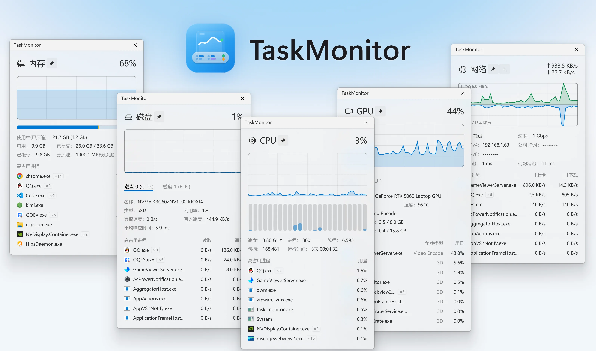

# TaskMonitor

> **个人修改版 · 非上游发布** — 基于 [linesoft2/TaskMonitor](https://github.com/linesoft2/TaskMonitor) `v2026.11.7.1`（作者 **双霖 (LineSoft)**，Apache-2.0）。
>
> **当前版本 `2026.11.12.2`**　｜　**[⬇ 下载安装包](../../releases)**　｜　Windows 10 / 11，免安装，无需额外运行时
>
> 包内含 `说明与改动.md` 与两份 `【必读】` 文档。与上游行为冲突时以上游为准；
> 具体改动见下文「本分支相对原版的改动」，条款依据与许可声明见文末「本分支来源与许可」。

**中文** | English (TODO)

**通过常驻的任务栏视图或悬浮窗**，从进程维度实时监测系统负载情况。

  

## 本分支相对原版的改动

### 新增

**① 使用方式与数据能力**

- **托盘图标**：蓝底白折线。左键把显示叫回来（丢了→重显示、真没了→重建、被「显示桌面」
  盖住→临时置顶 5 秒），右键弹与悬浮窗相同的菜单。**这是原版没有的第二个入口**。
- **多月流量历史**：跨月时把上月最终数字写进 `net_history.json`（与 exe 同目录），
  **默认保留 3 个月**，可选 3 / 6 / 9 / 12（上限 12），超出自动裁掉最早的。
  原版只有「本月 / 今日」，过了月就归零。
- **「往月」一行**：「网络」详情弹窗底部可选显示 `往月：9月 28.50 GB、10月 161.00 GB`。
  **默认关闭**，关掉仍照常静默记录；跨年月份写完整年份（`2025年12月`）。

**② 数值显示**

- **实时速率加 GB/s 档**：`B/s → KB/s → MB/s → GB/s`；MB/s 与 GB/s 两位小数，KB/s 一位。
  万兆跑满不再印成四位数的 `1250.0 MB/s`，而是 `1.22 GB/s`。

**③ 外观与交互**

- **已用走势曲线**：设置 → 外观 → 已用走势。每个指标背后叠一条使用率曲线，固定 0–100% 刻度，
  底部带基准线，自动从右往左滚动。默认关闭。只画最新 20 个采样点（点数不是秒数，
  可见跨度 = 20 × 采样间隔）。
- **网络 ↑/↓ 曲线**：上传、下载各自一条，按窗口峰值自适应缩放。
- **曲线颜色**：6 个预设 + 「跟随系统」，系统换色不必重启。
- **设置页折叠**：「网络流量统计」（固定 GB / 历史保留 / 显示往月）与「已用走势」（曲线颜色）
  改为可折叠分组，常用开关留在标题行 —— 页面不再越加越长。
- **关于页署名**：「关于」页底部标注「个人修改版 · 非官方发布 / 修改：yimeng007 / 上游：…」，
  与文末「本分支来源与许可」的条款依据相对应。

**④ 布局适配**

- **任务栏位置三档**：任务栏最左端 / 贴近开始按钮 / 贴近系统托盘，开关关闭时固定最左端。
- **竖排任务栏自动避让**：任务栏在屏幕左/右侧时，按开始按钮的位置自动贴顶端或托盘上方，
  改「任务栏对齐方式」后自动换端，不用重启。
- **任务栏左对齐识别**：系统为「左对齐」时，横排会把「任务栏位置开关」锁死（点开会弹提示），
  首次启动向导也只给一个选项并说明原因。

### 修复

> 同样按影响排：先「显示闪烁 / 消失 / 卡住」，再「画不出」，最后「排版」。

**① 显示会闪、会消失、会卡住**

- **「全屏时隐藏」误判**：任务视图、显示桌面的壳窗口被当成全屏应用，隐藏 1 秒又弹回来。
  判定改为屏幕五点采样（≥4 点被同一窗口铺满才算全屏）+ 两拍确认。
- **「全屏时隐藏」反应慢**：跟着 1000 ms 采样节拍走，进出全屏要 1–2 秒。抽出独立 120 ms 探测定时器，
  实测进入 246 ms、退出 76 ms。
- **隐藏后恢复「可见但空白」**：`SW_HIDE → SW_SHOW` 后 DComp 呈现面不会自动接回，恢复时重绑合成内容并重绘。
- **贴边隐藏滑出去后卡住不收回**：修 evisceration 状态机。
- **悬浮窗右侧内容被切**（`KB/s` 显示不全）：修列宽。

**② 形状 / 位置不对**

- **侧边任务栏 + 悬浮模式变成 224×1440 细长条**：修尺寸计算。
- **竖排覆盖层停在图标旁边 / 盖住开始按钮**：修定位。
- **切换「任务栏对齐方式」的瞬间覆盖层会压住开始按钮**（只读注册表，没看实际布局）。
- **首次启动向导第三张卡落错位置**：修布局。

**③ 画不出来 / 点不动**

- **GPU 曲线不显示**（`HistoryFor` 漏了 GPU 分支）。
- **竖排 CPU 曲线顶不满**（只画在数值半格，改为横跨整块）。
- **颜色色板点击无效**（外层滚动容器抢走鼠标捕获）。

**④ 排版细节**

- **项目之间分割线不完整**（网络 ↑/↓、GPU 两行之间缺线）。
- **详情弹窗累计流量两行折行、行距不均**。
- **首次引导底部提示压住「跳过」**。

### 未改动

采样源与数据口径、详情弹窗的图表、单文件打包方式、提权流程，均沿用原版。

## 安装 & 使用

推荐在 Windows 11 中使用。**免安装**，下载解压后双击 `task_monitor.exe` 即可。

- **本分支下载（含预编译 exe）**：[Releases](https://github.com/yimeng007/TaskMonitor/releases)
- **本分支源码**：[yimeng007/TaskMonitor](https://github.com/yimeng007/TaskMonitor)
- **上游原版**：[CNB（大陆友好）](https://cnb.cool/linesoft2/TaskMonitor/-/releases) ｜ [GitHub](https://github.com/linesoft2/TaskMonitor/releases)

想自己编译：`dotnet build task_monitor.csproj -c Release`，产物在 `bin/Release/net48/`
（Costura 已把依赖打进单文件）。

在下载并打开后，可以在**系统任务栏**的左侧 / 右侧（取决于任务栏设置）看到常驻的任务栏窗口（如下图所示），点击某个项目即可查看该项的详情和该项目的高占用进程。

  

## 制作背景

当有程序执行高负载任务或系统卡顿时，我们经常需要查看系统的负载情况，同时，我们也希望定位到具体哪个程序/进程在执行高负载任务， TaskMonitor 由此诞生，它不仅可以常驻任务栏实时展示共五个维度的实时负载，在点击某个项目后，还能查看每个项目的详情以及各进程的负载情况。

## 特色

- 单文件，接近 native 级渲染，极低资源占用。
- 仅依赖现代 Windows 内置的 .NET Framework，无需安装第三方 runtime。
- Fluent2 (WinUI) 设计风格，贴近系统原生UI，界面现代美观。
- 与 Windows 任务管理器一致的采样方式和计算逻辑，确保数值准确。
- 支持与 Clash / Mihomo 集成，可采集经代理后的进程网速数据。
- 纯 Win32 接口实现，无驱动、Ring0 等内核级采集方式，不影响系统稳定性。
- 完全免费，非盈利性，开放源代码。

## 功能

- CPU：支持CPU利用率，速度，进程数，线程数，句柄数，运行时间和每个进程利用率的采集展示。
- 内存：支持内存占用率，内存占用详情，已提交，已缓存，分页池，非分页池和每个进程占用内存数值的采集和展示。
- 磁盘：支持按物理磁盘分别采集，支持磁盘占用率，磁盘名称，磁盘类型，利用率，读写速度，响应时间和每个进程的读写速度的采集和展示。
- GPU：支持多个 GPU 分别采集，支持 GPU 占用率，GPU 名称，利用率，温度，负载类型，显存占用情况以及每个进程的负载类型和占用率的采集和展示。
- 网络：支持按网卡分别采集，支持网卡实时速率，网络类型，SSID，WiFi 标准，协商速率，本机 IPv4，公网 IPv4 / IPv6，本地延迟，公网延迟和每个进程的实时网速的采集和展示；支持与 Clash / Mihomo 集成，从而在进程列表展示经过代理后的实时速率。
- 其他：支持深色 / 浅色模式，支持触控板、触摸屏，支持设置采样间隔，支持在进程列表合并相同程序等

## 限制

- 由于部分接口需要 UAC 权限，本工具将始终申请 UAC ，后续可能会对此进行优化。
- 由于本项目使用了多个未文档化的 API，随系统更新后可能存在兼容性问题，后续将逐步优化。
- 公网IP的采集会向第三方网站发起请求，可在设置关闭此功能。

## TODO

- [x] ~~Windows 10 兼容~~
- [x] ~~悬浮模式（适用于隐藏任务栏的情况）~~
- [ ] i18n
- [ ] 无障碍
- [ ] 副屏支持
- [ ] ARM64 支持

## 参考 / 致谢 / 开源许可

- [TrafficMonitor](https://github.com/zhongyang219/TrafficMonitor) ([License](https://github.com/zhongyang219/TrafficMonitor/blob/master/LICENSE))
- Windows 任务管理器
- [iNKORE.UI.WPF.Modern](https://github.com/iNKORE-NET/UI.WPF.Modern) ([License](https://github.com/iNKORE-NET/UI.WPF.Modern/blob/main/LICENSE.md))
- [DirectN](https://github.com/smourier/DirectN) ([License](https://github.com/smourier/DirectN/blob/master/LICENSE))
- [FluentWpfCore](https://github.com/TwilightLemon/FluentWpfCore) ([License](https://github.com/TwilightLemon/FluentWpfCore/blob/master/LICENSE.txt))
- [YamlDotNet](https://github.com/aaubry/YamlDotNet) ([License](https://github.com/aaubry/YamlDotNet/blob/master/LICENSE.txt))

## 本分支来源与许可

- **上游原版**：[linesoft2/TaskMonitor](https://github.com/linesoft2/TaskMonitor)，作者 **双霖 (LineSoft)**
- **本分支基线**：上游 **v2026.11.7.1**（2026-11-07 发布）。版本号改为 `2026.11.12.2` 以便与上游区分
- **本分支仓库**：[yimeng007/TaskMonitor](https://github.com/yimeng007/TaskMonitor)
- **许可**：[Apache License 2.0](LICENSE) —— 与原版一致，本分支的修改同样以 Apache-2.0 授权发布
- **优先级**：本分支为个人修改版，非官方发布。与原版冲突时**以原版为准**；原版有任何问题请反馈给原作者

### 条款依据

本分支的署名方式逐条对应 Apache License 2.0 原文：

**一、修改声明（§4(b)）**

条款：「必须使任何修改过的文件带有显著的声明，说明你更改了文件。」

落实：源码改动见仓库提交记录与包内 `说明与改动.md`；程序「关于」页底部标注「个人修改版 · 非官方发布 / 修改：yimeng007 / 上游：github.com/linesoft2/TaskMonitor」。

**二、保留声明（§4(c)）**

条款：「必须保留……所有版权、专利、商标和归属声明。」

落实：原作者版权行 `Copyright © 2026 双霖 (LineSoft)` 原样保留于本文件「版权信息」；随包 `LICENSE` 为 Apache-2.0 原件，未作任何改动。

**三、商标与名称（§6）**

条款：本许可证不授予使用许可方商号、商标、服务标记或产品名称的权利（为描述作品来源所必需的合理使用除外）。

落实：仅作客观来源说明，不使用「官方」「授权」「合作」等表述；原作者姓名不用于产品名或版本号，末位 `.2` 仅用于与上游版本区分。

原作者如对署名方式或位置有异议，按其要求调整；版权声明与 `LICENSE` 属许可义务，不删除。

本分支为个人修改版，未获上游项目认可；如需反馈原版问题，请前往上游仓库。

## 版权信息

Copyright © 2026 双霖 (LineSoft).

请在 [Apache License 2.0](LICENSE) 的许可下使用。
