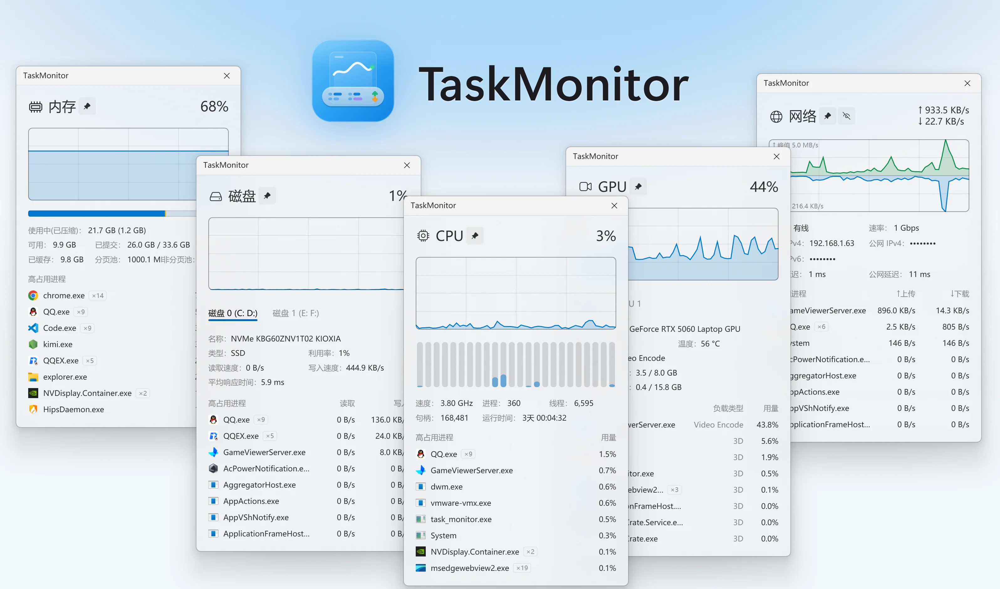

# TaskMonitor

> **个人修改版 · 非上游发布** — 基于 [linesoft2/TaskMonitor](https://github.com/linesoft2/TaskMonitor) `v2026.11.7.1`（作者 **双霖 (LineSoft)**，Apache-2.0）
>
> **当前版本 `2026.11.24.2`**　｜　**[⬇ 下载安装包](https://github.com/yimeng007/TaskMonitor/releases)**　｜　Windows 10（1607+）/ 11，免安装
>
> **系统要求：Windows 10（1607+）/ Windows 11，64 位。** Windows 7 / 8 / 8.1 不支持 —— 覆盖层依赖 DirectComposition 与 Win10 的 DWM 接口。
>
> 包内含 `版本说明-YYYY.MM.DD.N.md` 与两份 `【必读】` 文档（各含 `.md` 与 `.html` 两版）。
> 与上游行为冲突时以上游为准；条款依据与许可声明见文末「本分支来源与许可」。

**中文** | English (TODO)

**通过常驻的任务栏视图或悬浮窗**，从进程维度实时监测系统负载情况。

<p align="center">
  
</p>

## 特色
- 单文件，接近 native 级渲染，极低资源占用。
- 仅依赖现代 Windows 内置的 .NET Framework，无需安装第三方 runtime。
- Fluent2 (WinUI) 设计风格，贴近系统原生 UI。
- 与 Windows 任务管理器一致的采样方式与计算逻辑。
- 支持与 Clash / Mihomo 集成，可采集经代理后的进程网速。
- 纯 Win32 接口实现，无驱动、无 Ring0 采集。
- 完全免费，非盈利性，开放源代码。

## 安装 & 使用

> **数据放在哪**：`settings.yaml` / `net_history.json` / `logs\` 默认跟 exe 同目录（绿色版）。
> 把 exe 单独拷到桌面、下载、临时目录或盘符根目录运行时，为避免权限问题，
> 数据改放 `%LOCALAPPDATA%\TaskMonitor\`（首次切换会自动复制旧配置，只复制不删除）。
> 想直接打开这个目录：按 **Win+R**，粘贴 `explorer %LOCALAPPDATA%\TaskMonitor` 回车即可。

> **第一次运行被系统拦了？** 常见几种：SmartScreen 蓝窗口（点「更多信息 → 仍要运行」）、
> UAC「管理员已阻止」、Win11「智能应用控制」、杀软弹窗或右下角通知。逐项处理见
> **[已知限制.md](已知限制.md#七安装时被系统拦截怎么办)**。

**系统要求：Windows 10（1607 及以上）/ Windows 11，64 位**；另需 .NET Framework 4.8（系统自带）。

**免安装**，解压后双击 `task_monitor.exe` 即可。首次运行会请求管理员权限 ——
按进程统计网络流量依赖 Windows 的 SRUM 实时接口，普通权限读不到。

- **本分支下载（含预编译 exe）**：[Releases](https://github.com/yimeng007/TaskMonitor/releases)
- **本分支源码**：[yimeng007/TaskMonitor](https://github.com/yimeng007/TaskMonitor)
- **上游原版**：[CNB（大陆友好）](https://cnb.cool/linesoft2/TaskMonitor/-/releases) ｜ [GitHub](https://github.com/linesoft2/TaskMonitor)

<p align="center">
  
</p>

## 功能

- **CPU**：利用率、速度（含睿频）、进程数、线程数、句柄数、运行时间，以及每个进程的 CPU 占比。
- **内存**：占用率、占用详情、已提交、已缓存、分页池、非分页池、硬件保留，以及每个进程的内存占用。
- **存储**：按物理磁盘分别采集（占用率、类型、读写速度、响应时间、IOPS），
  另含温度 / 通电时长 / 剩余寿命（NVMe 与 SATA），以及每个进程的读写速度。
- **GPU**：多卡分别采集（利用率、温度、专用/共享显存、功耗、风扇、显存带宽），以及每个进程的 GPU 占用。
- **网络**：按网卡分别采集（实时速率、类型、SSID、Wi-Fi 标准与频段），
  本月 / 今日流量、多月历史、丢包与错误计数，以及每个进程的网络速率。
- **其他**：深色 / 浅色主题、触控与手势滚动、采样间隔可调、开机自启动（默认关闭，
  走系统「任务计划」，登录时以最高权限启动，不弹 UAC）。

## 这一版改了什么（2026.11.24.2）

### 新增

- **「磁盘」页改名「存储」页**
  内置盘进标签行，插几块显示几块，超出宽度用左右箭头翻页；外接 U 盘 / 移动硬盘单独放在
  底部「外部存储」区块，只显示类型与容量（实时读写对移动盘代价太高，故意不做）。
- **磁盘曲线可切「汇总 / 单盘」**
  默认汇总；关掉后按 `C:/D:/E:` 标签看单块盘的曲线，选择在本次运行内记忆。
- **GPU 页补齐功耗 / 风扇 / 显存带宽**
  仅 NVIDIA（驱动自带 NVML）：整卡功耗（W）、风扇转速百分比（多风扇取最大值）、
  显存控制器占用。AMD / Intel 显示 `--`，原因见「限制」。
- **内存页补齐五项**
  已提交、已缓存、分页池、非分页池、硬件保留；页面文件改为读取系统真实数值。
- **SATA 硬盘也能读温度 / 通电时长 / 剩余寿命**
  NVMe 之外补上 SATA 通道；USB 硬盘盒能否读到取决于是否透传 SMART，读不到显示 `--`。
- **每个数据项都有悬停说明**
  五个详情窗口六十多个字段与列表列头，鼠标停一下就有「这是什么、怎么看」，
  长数字的精确值也放在提示里。
- **横条内的百分比**
  存储容量条、GPU 显存条的百分比贴着填充边界显示：浅色主题按底色深浅取黑/白字，
  深色主题一律白字。
- **标签行左右翻页**
  点箭头一次挪两个标签的宽度（原来只挪一小段）。
- **数字过长自动缩写**
  进程 / 线程 / 句柄 / 丢包 / 错误 / 连接数：一百万以内显示完整数字，超过按「万 / 亿」缩写，
  悬停可看精确值。

### 修复

- **注销后重新登录，程序不启动**
  旧版注销时可能留下没有窗口的残留进程，系统随后跳过自启动；本版退出时确保进程完全结束，
  自启动另加 10 秒延迟与每 10 分钟一次的补启动。
- **托盘右键菜单偶尔关不掉**
  点桌面空白处时菜单有时不消失；现在点菜单外任意位置都会立即收起。
- **点「退出」后鼠标卡几秒**
  现在退出瞬间完成（约 17 毫秒），鼠标立即恢复正常。
- **启动后第一下点击没反应**
  旧版启动时一次性准备好五个详情页，期间点任务栏要等一两秒；改为逐个准备，开窗即让路。
- **GPU 页两行文字重叠**
  专用 / 共享显存两行曾共用一个布局，数字长时压到一起，已拆开。
- **深色主题下横条看不见**、**拔掉移动硬盘后底部留白**、
  **内存双通道判断偏差**、**GPU 只读到第一个风扇**、**几处悬停说明写错页面** —— 均已修正。

### 性能

- **启动**：冷启动约 1.1 秒出现任务栏图标，暖启动约 0.16 秒；启动后不再有「第一下卡顿」。
- **退出**：手动退出约 17 ms（上一版 39~44 ms）；注销 / 关机约 10~20 ms。
- **移动硬盘不再拖慢程序**：外接盘的慢速查询移出每秒采样。
- **慢盘自动降频**：单次查询超过 0.8 秒的硬盘改为三秒一次。

### 说明补得更清楚

- **设置里的「显示方式」**：写明它只影响任务栏 / 悬浮窗上的数字，详情窗曲线另由「汇总 / 单盘」控制。

- **GPU 曲线与标签**：悬停提示说明「切标签只改明细」，曲线仍按设置中的显示方式。

- **存储页的「汇总 / 单盘」**：提示里补了「任务栏数字另由设置决定」。

> 本版 19 条在上面都已列出；**从第一个修改版到现在的全部改动**（48 条，按主题分七组）→
> **[改动清单.md](改动清单.md)**。**限制与安装拦截的处理办法**（为什么有些值是 `--`、
> 显卡驱动对照、7 种被拦场景）→ **[已知限制.md](已知限制.md)**。

## 常见已知限制

- **CPU 温度不显示** —— Windows 没有可靠接口，读 MSR 需内核驱动（有蓝屏风险），不做。
- **AMD / Intel 显卡的功耗与风扇不显示** —— 需要 ADLX / IGCL 接口，本版未接入；NVIDIA 有。
- **移动硬盘不显示实时读写与 SMART** —— 硬盘盒的桥接芯片查询慢、且多数不透传 SMART。
- **Wi-Fi 名称 / 标准 / 频段** —— Windows 11 需开启「位置」权限，程序无权代开。
- **必须管理员权限** —— 按进程统计流量依赖 SRUM 实时接口，普通权限读不到。
- **不支持 Windows 7 / 8 / 8.1 与 ARM64** —— 覆盖层依赖 DirectComposition 与 Win10 的 DWM 接口。

> 以上是常见的六条。**完整清单**（显卡驱动对照表、为什么有些值是 `--`、
> 联网行为与隐私说明、7 种安装被拦截的处理办法）→ **[已知限制.md](已知限制.md)**。

## 制作背景
当有程序执行高负载任务或系统卡顿时，我们经常需要查看系统的负载情况，
同时也希望定位到具体哪个程序在占用资源。TaskMonitor 由此诞生：它常驻任务栏，
实时展示五个维度的负载；点开任意一项还能看详情与该维度的高占用进程。

## TODO
- [x] ~~Windows 10 兼容~~
- [x] ~~悬浮模式（适用于隐藏任务栏的情况）~~
- [ ] i18n
- [ ] 无障碍
- [ ] 副屏支持
- [ ] ARM64 支持

## 参考 / 致谢 / 开源许可
上游原有的参考与致谢沿用不变，逐项如下：

- [TrafficMonitor](https://github.com/zhongyang219/TrafficMonitor)（MIT）—— 任务栏显示与悬浮窗的思路
- Windows 任务管理器 —— 采样方式与计算口径
- [iNKORE.UI.WPF.Modern](https://github.com/iNKORE-NET/UI.WPF.Modern)（MIT）—— Fluent 控件与主题
- [DirectN](https://github.com/smourier/DirectN)（MIT）—— DirectX / DWM 互操作
- [FluentWpfCore](https://github.com/TwilightLemon/FluentWpfCore)（MIT）—— 亚克力背景
- [YamlDotNet](https://github.com/aaubry/YamlDotNet)（MIT）—— 配置读写

以上均为上游项目所引，本分支沿用。

**本版新增的参考**（仅参考调用方式与字段含义，未复制源码）：

- [CrystalDiskInfo](https://github.com/hiyohiyo/CrystalDiskInfo)（MIT）—— NVMe SMART 字段定义
- [smartmontools](https://github.com/smartmontools/smartmontools)（GPL-2.0）—— SATA SMART 属性含义
- [LibreHardwareMonitor](https://github.com/LibreHardwareMonitor/LibreHardwareMonitor)（MPL-2.0）—— 显卡风扇 / 功耗读取方式

## 本分支来源与许可
- **上游原版**：[linesoft2/TaskMonitor](https://github.com/linesoft2/TaskMonitor)，作者 **双霖 (LineSoft)**
- **本分支基线**：上游 **v2026.11.7.1**（2026-11-07 发布）。版本号形如 `2026.11.24.2` —— 前段是日期，**末位 `.2` 表示个人修改版**（上游末位恒为 `.1`）
- **本分支仓库**：[yimeng007/TaskMonitor](https://github.com/yimeng007/TaskMonitor)
- **历史版本**：见 [Releases](https://github.com/yimeng007/TaskMonitor/releases)
- **许可**：[Apache License 2.0](LICENSE) —— 与原版一致，本分支的修改同样以 Apache-2.0 授权发布
- **优先级**：本分支为个人修改版，非官方发布。与原版冲突时**以原版为准**；原版有任何问题请反馈给原作者

### 条款依据

本分支的署名方式逐条对应 Apache License 2.0 原文：

**一、修改声明（§4(b)）**

条款：「必须使任何修改过的文件带有显著的声明，说明你更改了文件。」

落实：源码改动见仓库提交记录与包内 `版本说明-YYYY.MM.DD.N.md`；程序「关于」页底部标注「个人修改版 · 非官方发布 / 修改：yimeng007 / 上游：github.com/linesoft2/TaskMonitor」。

**二、保留声明（§4(c)）**

条款：「必须保留……所有版权、专利、商标和归属声明。」

落实：原作者版权行 `Copyright © 2026 双霖 (LineSoft)` 原样保留于本文件「版权信息」；随包 `LICENSE` 为 Apache-2.0 原件，未作任何改动。

**三、商标与名称（§6）**

条款：本许可证不授予使用许可方商号、商标、服务标记或产品名称的权利（为描述作品来源所必需的合理使用除外）。

落实：仅作客观来源说明，不使用「官方」「授权」「合作」等表述；原作者姓名不用于产品名或版本号，末位 `.2` 仅用于与上游版本区分。

原作者如对署名方式或位置有异议，按其要求调整；版权声明与 `LICENSE` 属许可义务，不删除。

本分支为个人修改版，未获上游项目认可；如需反馈原版问题，请前往上游仓库。

### 免责与数据说明

**一、按「现状」提供（Apache-2.0 §7）**

本软件不提供任何明示或默示的担保，包括但不限于适销性、特定用途适用性与不侵权担保。
因使用或无法使用本软件造成的任何直接或间接损失（数据丢失、统计误差、误判为异常流量等），
作者不承担责任。**流量统计仅供参考，一切以运营商账单为准。**

**二、需要管理员权限**

本软件以提升权限运行，以便读取系统自带的流量统计数据库（SRUM）、磁盘与 GPU 计数器。
请自行确认所下载文件的来源可信（校验值见 Release 页），不要在来路不明的渠道获取。

**三、数据外发（请务必知悉）**

| 行为 | 外发内容 | 触发条件 |
| --- | --- | --- |
| 查询公网 IP / 地区 | 向公开的 IP 查询站点发起 HTTPS 请求；**这些站点能看到你的出口 IP** | 开启「公网 IP」采样项时（默认开启） |
| Clash / Mihomo 集成 | 仅访问你填写的本机地址（默认 `127.0.0.1:9090`），密钥只用于本地请求 | 手动开启该集成时 |

除此之外：**不上报、不统计、无遥测**；配置、日志、流量历史全部只存本机
（与 exe 同目录，或 `%LOCALAPPDATA%\TaskMonitor\`）。不收集、不上传任何文件、进程列表或账号信息。

**四、合规使用**

使用代理、加速器等网络工具时，请遵守所在地区法律法规与相关服务条款。
本软件只做本机流量与接口状态的显示，不提供、不修改任何网络代理能力。

## 版权信息

- **上游部分**：Copyright © 2026 双霖 (LineSoft).
- **本分支的修改与新增**：Copyright © 2026 yimeng007.

两者均按 [Apache License 2.0](LICENSE) 提供；本分支的修改同样对任何人开放使用、修改与再分发。
修改范围与版权归属另见 [NOTICE](NOTICE)（许可证正文未作任何改动）。


## 自己编译

源码在本仓库根目录（`task_monitor.csproj` 与 `src/`）。装好 .NET SDK 后，在仓库根目录执行：

```
dotnet build task_monitor.csproj -c Release
```

产物在 `bin/Release/net48/`（编译时自动生成，仓库里不含该目录；`.gitignore` 已忽略 `bin/` 与 `obj/`），
依赖已打进单文件（Costura），拷走 exe 即可运行。

> **修改前先备好环境**：先跑一次 `dotnet build -c Release` 确认能编译通过，再动手改。
> 重新编译出的 exe 没有数字签名，Windows 可能提示「未知发布者」（右下角安全提示），
> 首次运行选「更多信息 → 仍要运行」；建议先备份原 exe 与数据目录
> （`settings.yaml`、`net_history.json`、`logs` 目录）。

**许可**：本程序按 [Apache License 2.0](LICENSE) 提供。自己改完再分发时，请：

- 保留 [`LICENSE`](LICENSE) 与 [`NOTICE`](NOTICE)，不要改动许可证正文；
- 在说明里注明来源（作者、仓库地址），让读者知道你这份是从哪里来的；
- 写清你改了哪些地方（增删了哪些功能、动了哪些默认值）；
- 不要用原作者或本分支的名义给你的版本背书，也不要把未修改的部分说成自己写的。

<!-- 本仓为发布仓：版本与下载链接见上方块引用；完整改动见 改动清单.md。 -->
